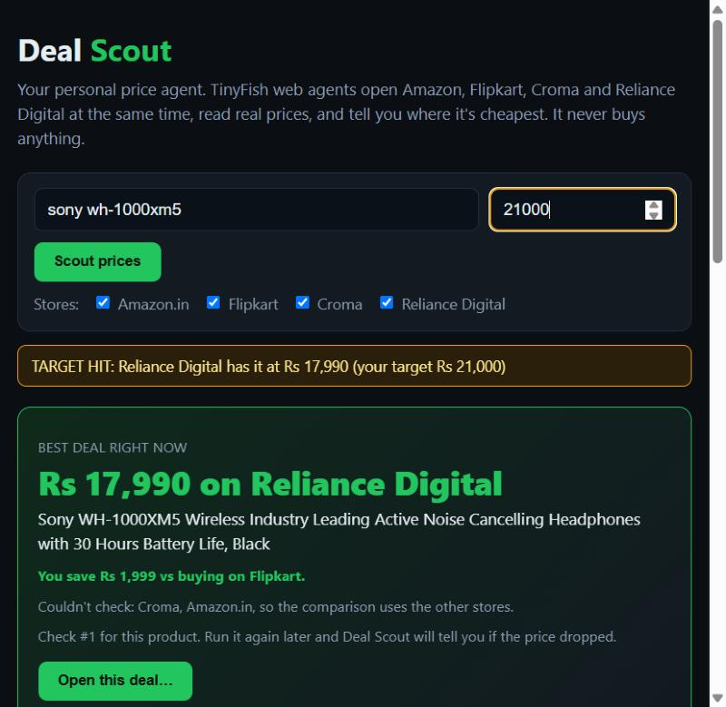
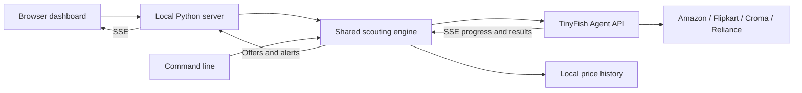

# Deal Scout

**Compare product prices across Indian stores with TinyFish browser agents.**

Deal Scout turns a product query into a live comparison across Amazon.in, Flipkart, Croma, and Reliance Digital. It is a local Python app with a browser dashboard and a command-line interface, plus a separate Claude Code skill for the TinyFish MCP connector.

Type a model such as `sony wh-1000xm5`, optionally set a target price, and select your stores. Each store gets a TinyFish agent that reads search results, filters unrelated listings, and returns structured offers. Deal Scout shows progress, compares returned prices, and records changes since the previous check.

[Setup and usage](docs/USAGE.md) · [Technical architecture](docs/ARCHITECTURE.md) · [Demo and submission](docs/SUBMISSION.md) · [UI design notes](docs/UI_PLAN.md)



*Saved example screenshot; displayed prices are not current quotes.*

## What it does

- Checks up to four stores concurrently, subject to TinyFish account capacity.
- Streams each agent's progress and exposes a watch link when TinyFish supplies one.
- Displays each store's offers as soon as that store finishes.
- Selects the cheapest returned offer not explicitly marked out of stock.
- Shows discounts against listed MRP and target-price alerts.
- Saves local price history and compares it with the previous check.
- Supports repeated CLI checks and an offline replay demo.

The app does not implement login, cart, or checkout actions. Its agent instructions prohibit purchases and entering personal details. Opening an offer in your browser requires confirmation by default; the CLI's explicit `--yes-open` option skips that prompt. Agents may open a product page themselves to check availability during research.

## Quick start

Requires **Python 3.10+**. The app uses only the Python standard library; no package installation or frontend build is needed. Run the commands below from the repository root.

### Try the saved demo

```sh
python server.py --replay
```

Open [localhost:8787](http://localhost:8787), enter **sony wh-1000xm5**, and click **Compare prices**. Replay needs no API key and uses the bundled recording. Other queries require matching recordings. The dashboard displays a **Recorded demo** badge once replay activity begins. Replay also writes to local price history.

### Check live prices

Create `.env` beside `agent.py`:

```dotenv
TINYFISH_API_KEY=your-key-here
```

Use a real TinyFish API key for live runs. `.env` is ignored by Git. Existing environment variables take precedence over values in this file. Stop the replay server before starting the live server, and remove any `DEALSCOUT_REPLAY` environment setting.

```sh
python server.py
```

The dashboard runs at [localhost:8787](http://localhost:8787). Live checks use your TinyFish account and may consume credits.

### Use the terminal

```sh
python dealscout.py "sony wh-1000xm5" --target 20000
python dealscout.py "boat airdopes 141" --stores amazon flipkart
python dealscout.py "sony wh-1000xm5" --target 18000 --every 360
```

The last command checks again 360 minutes after each run finishes, while the process stays open. Watch mode never opens a browser. See [usage](docs/USAGE.md) for all options, configuration, and troubleshooting.

## How it works



The Python app calls TinyFish's Agent API directly. The [Claude Code skill](.claude/skills/deal-scout/SKILL.md) is a separate way to perform a similar workflow using an installed TinyFish MCP connector. This repository does **not** implement an MCP server.

See [technical architecture](docs/ARCHITECTURE.md) for components, request flow, event payloads, data models, failure handling, and extension points.

## Repository layout

```text
TinyfishBrowserMCP/
├── README.md                 # Project front page
├── agent.py                  # TinyFish client, scouting, normalization, history
├── server.py                 # Local HTTP server and SSE bridge
├── dealscout.py              # CLI and watch mode
├── ui.html                   # Dashboard: HTML, CSS, and JavaScript
├── .gitignore
├── .env                      # Local credentials (ignored, created by you)
├── price_history.json        # Local history (ignored, generated)
├── recordings/              # Saved TinyFish results for replay
├── docs/
│   ├── ARCHITECTURE.md
│   ├── USAGE.md
│   ├── SUBMISSION.md
│   ├── UI_PLAN.md            # UI design notes and remaining ideas
│   └── screenshots/
└── .claude/
    ├── launch.json           # Live and replay launch configurations
    └── skills/deal-scout/SKILL.md
```

The application previously lived inside a nested `dealscout/` folder. Its runtime files, local `.env`, and history now live at the repository root; documentation and screenshots live under `docs/`.

## Interpreting results

“Best deal” means the lowest eligible price among the offers returned by this check, not an exhaustive market search. Agents inspect the first results page and are asked for up to three matches per store by default.

Unknown availability remains eligible for the best offer, and the dashboard labels it as unconfirmed. History records each store's minimum returned price, including out-of-stock listings; it does not retain variant or stock details. The dashboard excludes explicitly out-of-stock offers when displaying the lowest eligible price and ties. Check product variants, availability, delivery charges, and conditional discounts on the store before deciding.

This is a local prototype: history is a JSON file, the server has no authentication, and there is no hosted scheduler or push notification service. It binds to `127.0.0.1`. The [architecture guide](docs/ARCHITECTURE.md) documents these limits and the distinction between shipped behavior and proposed work.
