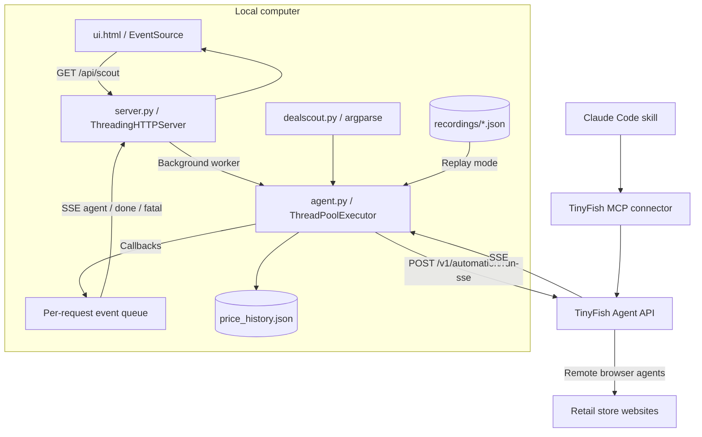

# Technical architecture

[Project overview](../README.md) · [Setup and usage](USAGE.md)

This document describes the implementation in this repository as of 14 October 2026. [UI_PLAN.md](UI_PLAN.md) contains proposed design work; it is not a description of all shipped features.

## System boundary

Deal Scout is a local Python application for comparing returned retail offers. Python runs orchestration, normalization, ranking, and persistence. TinyFish runs remote browsers and extracts product information from store pages. The local browser displays the interface and consumes progress through server-sent events (SSE).

The runtime uses Python 3.10+ standard-library modules and a single HTML file with inline CSS and JavaScript. There is no frontend build, database service, application framework, or MCP server implementation. The Claude Code skill is an alternative connector workflow, separate from the Python request path.



## Components

| File | Responsibility |
| --- | --- |
| [`agent.py`](../agent.py) | Store search templates, extraction goal and schema, HTTP/SSE client, retries, replay, parallel scouting, offer parsing, best-offer selection, history. |
| [`server.py`](../server.py) | Loopback HTTP server, dashboard delivery, store/history endpoints, per-request worker and SSE queue. |
| [`ui.html`](../ui.html) | Store selection, query submission, progress cards, incremental offers, final comparison and confirmation dialog. |
| [`dealscout.py`](../dealscout.py) | CLI arguments, terminal progress/results, repeat checks, optional browser opening. |
| [`recordings/`](../recordings/) | Recorded provider results selected by exact search URL for offline playback. |
| [Connector skill](../.claude/skills/deal-scout/SKILL.md) | Instructions for a separate TinyFish MCP workflow using async runs and polling. |

## Lifecycle of a web check

1. The browser loads `/` and fetches `/api/stores` to create store checkboxes.
2. Submission creates an `EventSource` for `/api/scout?q=...&target=...&stores=...`. Each connection starts a new check; this is not a resumable subscription.
3. The handler creates a queue and a daemon worker. The worker calls `scout()` with three requested offers per store and four local threads.
4. Each `scout_store()` URL-encodes the query, selects a store search URL, builds a goal, and invokes either the live SSE client or replay runner.
5. The live client POSTs a JSON body with `url`, `goal`, `browser_profile: "stealth"`, `api_integration: "dealscout"`, and `output_schema`. It authenticates with `X-API-Key`.
6. The client reads JSON from `data:` lines. It relays events, captures the run ID and streaming URL, and returns the first `COMPLETE` event. This is a line-oriented reader, not a full multiline SSE parser.
7. A completed store result is normalized into `Offer` objects. `scout()` gathers futures in completion order and emits a synthetic `STORE_RESULT` event immediately for each store.
8. After all stores finish, the worker records history, chooses the best offer, and queues `done`. The browser closes the EventSource and renders the final summary. Exceptions at the worker boundary produce `fatal`.

The queue separates callbacks from the HTTP writer. Idle queues send an SSE comment heartbeat every 15 seconds. The CLI calls the same core synchronously, printing events instead of relaying them through HTTP.

## HTTP contract

All routes use GET. The server binds to `127.0.0.1:8787` and provides no authentication.

| Route | Response | Notes |
| --- | --- | --- |
| `/` | `text/html` | Reads `ui.html` from disk. |
| `/api/stores` | JSON object | Store keys mapped to display names. |
| `/api/history` | JSON object | Entire local history, or `{}` if missing/invalid JSON. |
| `/api/scout` | `text/event-stream` | Starts work and streams its results; can consume live API credits. |

`/api/scout` accepts `q` (required, trimmed), `stores` (comma-separated keys), and `target` (optional float). A missing/empty `q` returns HTTP 400. Unknown store keys are filtered; if nothing valid remains, the server uses all four stores. A malformed target is not cleanly validated before streaming and can terminate the request. Other paths return 404.

| SSE event name | Data | Meaning |
| --- | --- | --- |
| `agent` | `{"store":"Amazon.in","type":"PROGRESS","purpose":"..."}` | Relayed provider event, with display store name. Types used by the UI include `STARTED`, `STREAMING_URL`, `PROGRESS`, and `COMPLETE`. |
| `agent` | `{"store":"Amazon.in","type":"STORE_RESULT","result":{...}}` | Synthetic event containing one normalized `StoreResult`. |
| `done` | `{"results":[...],"best":{...},"alerts":[...],"runs":1}` | Final comparison. `best` may be null; `runs` is the retained history count, capped at 50. |
| `fatal` | `{"error":"..."}` | Failure at the worker boundary. Individual store failures usually appear inside results instead. |

The `best` object contains the dataclass fields only. Offers inside `results` also include computed `discount_pct`. The protocol has no resumable event IDs, persisted job lookup, or client cancellation endpoint. The UI explicitly closes the EventSource on error because automatic reconnect would start another check. Disconnecting does not stop the worker.

## Extraction and data model

The agent goal asks for up to `top_n` matching products from the first results page, skipping unrelated accessories. It prohibits login, cart, buy actions, and entering personal details. It permits opening the single cheapest match to inspect online availability. These are remote-agent instructions rather than local browser action enforcement.

`OUTPUT_SCHEMA` requires a `products` array. Each product requires `title` and numeric `price`; optional fields are `mrp`, `rating`, `in_stock`, and `url`. An optional `blocked_reason` explains an empty result. The local parser tolerates direct lists and some wrapped result objects, skips entries without a nonempty title or positive price, parses formatted numeric strings, and resolves relative URLs against the search URL. It does not run a full JSON Schema validator or verify product equivalence.

| Model | Fields |
| --- | --- |
| `Offer` | `store`, `title`, `price`, optional `mrp`, `rating`, `in_stock`, `url`; computed `discount_pct` when MRP exceeds price. |
| `StoreResult` | `store`, `ok`, `offers`, optional `error`, `run_id`, `streaming_url`, and elapsed `seconds`. |

`ok` means at least one offer parsed, not that stock was confirmed. No matches, blocked pages, and technical failures share `ok: false`; there are no structured failure codes.

### Ranking and availability

`best_offer()` takes the minimum price among offers where `in_stock is not False`. Missing availability is therefore eligible. Explicitly unavailable offers remain visible but cannot win. Equal-price ties resolve to the first encountered offer; because results arrive in completion order, the winning store can vary between tied runs.

The UI displays equal-price ties among eligible offers, labels unknown availability, and excludes explicitly unavailable listings from its lowest-price display. It no longer claims cross-store savings because the backend does not verify that variants or purchase conditions match. There is no delivery-fee, bank-offer, coupon, membership, or tax normalization. Interpret the result as the lowest eligible returned listing, not a guaranteed checkout price.

## Concurrency, retries, and time limits

`scout()` uses `ThreadPoolExecutor`, defaulting to four workers. Remote concurrency depends on TinyFish account capacity; local thread count does not guarantee four simultaneous remote browsers. A store exception becomes a failed `StoreResult` so other stores can complete.

| Condition | Current handling |
| --- | --- |
| HTTP 429/503 | Fixed 15-second delay and up to four retries, using the shared attempt counter. |
| Other HTTP 4xx | No retry. |
| Other `TinyFishError` | Normally one retry after three seconds, except the explicit browsing-timeout error. |
| Non-completed terminal status | Normally one retry; `CANCELLED` is not retried. |
| Completed but no parsed offers and no `blocked_reason` | One retry by default. |
| Empty result with a reason | Report the reason without retrying. |
| Browsing budget exceeded | Best-effort POST to `/v1/runs/{run_id}/cancel`; mark the store timed out without retrying. |

The defaults are `retries=1` and a 240-second browsing budget. Browsing timing starts on `STREAMING_URL` and is checked while processing subsequent JSON data events. Queue time is excluded, and a silent stream cannot trigger that check until more data arrives. The underlying `urlopen` timeout is 300 seconds; it is not an overall job deadline. Cancellation errors are swallowed, so a cancellation attempt is not proof of remote termination. Exceptions outside `TinyFishError` are caught at the future boundary without the same retry logic.

## Persistence and replay

History is a read/modify/write JSON file beside `agent.py`:

```json
{
  "sony wh-1000xm5": {
    "runs": [
      {
        "at": "2026-10-14T12:00:00",
        "prices": {"Flipkart": 19989.0, "Amazon.in": 27490.0}
      }
    ]
  }
}
```

This is an illustrative record. Query keys are stripped and lowercased; timestamps use local time without a timezone offset. Only the last 50 runs per query are retained. Store prices include the cheapest returned offer regardless of stock. Alerts compare with the immediately previous run and are returned as human-readable strings. Targets, product identity, stock, mode, and currency metadata are not persisted.

Missing or malformed JSON is treated as empty history. Writes are neither locked nor atomic, so overlapping CLI/web checks can lose updates. Replay shares this same persistence path.

When `DEALSCOUT_REPLAY` is nonempty, `_replay_run()` reads recording arrays, finds the first record with an exact matching search URL, and emits `STARTED`, delayed `PROGRESS`, and `COMPLETE` events. It reuses recorded IDs and results; it neither starts a remote browser nor emits `STREAMING_URL`. The supplied goal/schema do not change a recorded result. New recordings are not captured automatically by live runs.

## Operational limits

- Credentials stay in the local Python process and its outbound API request; the UI does not need the API key. Queries and goals are sent to TinyFish, and the query appears in the local GET URL.
- The loopback server is intended for local use. It lacks authentication, request-level rate limits, robust input validation, and production deployment support.
- Extracted text is escaped in the UI, but outgoing URLs do not have a strict HTTP(S)/host allowlist. Confirmation is not URL validation.
- Closing the browser, stopping the process, or losing the stream does not reliably cancel remote runs. Repeating a check can create additional paid work.
- The dashboard shows recent query summaries from the history API. Watch mode belongs to the CLI; no durable scheduler or push notifications are implemented.
- Unknown stock, variants, and incomplete coverage constrain price comparisons. An all-out-of-stock run keeps the listings visible and says no available offer was found.

## Extending the app

To add a store, add its key, name, and encoded-query URL template to `STORES` in `agent.py`. The CLI choices and web catalogue derive from that dictionary. Update the connector skill separately because it has its own store table and instructions. Add a matching recording to exercise the new store offline.

To change extraction fields, update `OUTPUT_SCHEMA`, the goal, `Offer`, `parse_offers()`, serialization, and both presentation layers together. To change availability policy, align best-offer selection, UI ties/savings, and history rather than modifying only one calculation.

[The UI design notes](UI_PLAN.md) include further ideas. Durable jobs/cancellation, structured outcome and alert types, variant-aware history, timezone-aware timestamps, and concurrency-safe persistence require backend changes.
